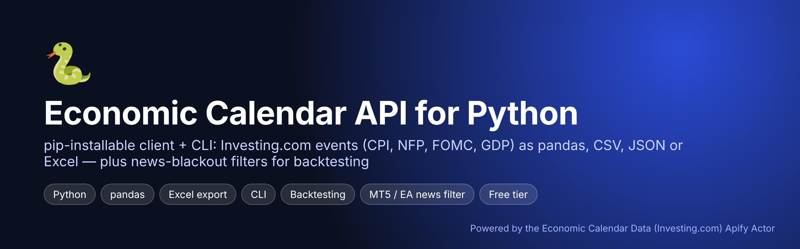
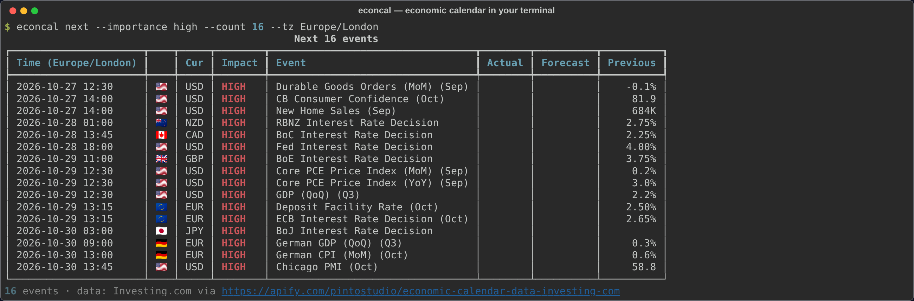
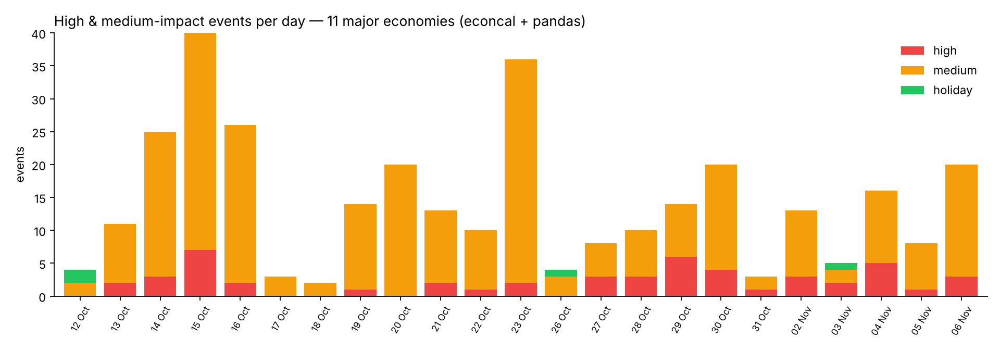

<p align="center"></p>

# Economic Calendar API for Python (`econcal`)

**Get the economic calendar in Python** — CPI, Nonfarm Payrolls, FOMC / Fed rate decisions, GDP, PMIs, central bank speeches and holidays for **97 countries**, with actual / forecast / previous values. As a **pandas DataFrame, CSV, JSON or Excel**, from a CLI or your own code.

`econcal` is a small client for the **[Economic Calendar Data (Investing.com) Apify Actor](https://apify.com/pintostudio/economic-calendar-data-investing-com)**, which scrapes the Investing.com economic calendar for you (no browser, no proxies, no HTML parsing on your side).

<p align="center"></p>

## Install

```bash
pip install git+https://github.com/BelNaruto/economic-calendar-python
export APIFY_TOKEN=apify_api_xxx     # free account: https://console.apify.com/settings/integrations
```

Try it offline first with the bundled real sample data: add `--sample tests/sample-events.json` (clone the repo).

## Use it from Python

```python
from econcal import load_events, to_dataframe

events = load_events(countries=["united states", "euro zone"], importance="high",
                     from_date="2026-10-12", to_date="2026-11-06")

df = to_dataframe(events)
print(df[["datetime_utc", "country", "event", "actual", "forecast", "previous", "surprise"]])

cpi = df[df.event.str.startswith("CPI (YoY)") & (df.country == "united states")]
fomc = df[df.event.str.contains("Fed Interest Rate Decision")]
```

Each event: `datetime_utc`, `date`, `all_day`, `country`, `currency`, `importance` (`high`/`medium`/`low`/`None` for holidays), `event`, `actual`, `forecast`, `previous`, and `surprise()` → `beat` / `miss` / `inline`.

## Command line

```bash
econcal fetch --countries us,ez,uk --importance high --from 2026-10-12 --to 2026-10-19        # pretty table
econcal fetch --countries us --days 30 --format xlsx --out us-calendar.xlsx                    # Excel
econcal fetch --countries all --importance high --format csv --out week.csv                     # CSV
econcal next --importance high --count 10 --tz America/New_York                                 # what's next
econcal blackout --currencies USD,EUR --before 15 --after 45 --out news_windows.csv             # trading filter
```

Country shortcuts: `us`, `ez`, `uk`, `jp`, `de`, `fr`, `ca`, `au`, `nz`, `ch`, `cn`, `uae` — or any full name (`brazil`, `south korea`, `portugal`…).

## Backtesting: skip trades around high-impact news

```python
from econcal import load_events, news_blackout_mask

events = load_events(countries=["united states", "euro zone"], importance="high",
                     from_date="2026-01-01", to_date="2026-10-31")
mask = news_blackout_mask(prices.index, events, before=15, after=45, currencies=("USD", "EUR"))
signals[mask] = 0          # flat 15 min before → 45 min after every USD/EUR 3-star release
```

`econcal blackout` writes the same windows as CSV (`start_utc,end_utc,currency,importance,event`) — easy to load in an MT4/MT5 Expert Advisor, a TradingView/Pine workflow, Freqtrade or any trading bot. See [`examples/news_filter_backtest.py`](examples/news_filter_backtest.py).

<p align="center"></p>

## Why an Apify Actor instead of scraping Investing.com yourself?

Investing.com blocks most scrapers (403 / JSON errors). The [Actor](https://apify.com/pintostudio/economic-calendar-data-investing-com) handles that, supports 97 countries, categories and importance filters, multi-country runs and returns clean JSON. It's pay-per-result (~$10 per 1,000 events): one week of US high-impact events is ~15–25 events ≈ $0.20. You can also use it directly over HTTP:

```bash
curl -X POST "https://api.apify.com/v2/acts/pintostudio~economic-calendar-data-investing-com/run-sync-get-dataset-items?token=$APIFY_TOKEN" \
  -H "Content-Type: application/json" \
  -d '{"countries":["united states","euro zone"],"importances":"high","fromDate":"2026-10-12","toDate":"2026-10-19"}'
```

## Development

```bash
git clone https://github.com/BelNaruto/economic-calendar-python && cd economic-calendar-python
pip install -e . pytest && pytest
```

## Related projects

- [economic-calendar-ics](https://github.com/BelNaruto/economic-calendar-ics) — add the economic calendar to Google Calendar / Apple / Outlook
- [economic-calendar-alert-bot](https://github.com/BelNaruto/economic-calendar-alert-bot) — Telegram & Discord alerts for CPI, NFP, FOMC
- [economic-calendar-dashboard](https://github.com/BelNaruto/economic-calendar-dashboard) — economic calendar this week, FOMC/CPI/NFP countdowns

Not investment advice. MIT licensed.
